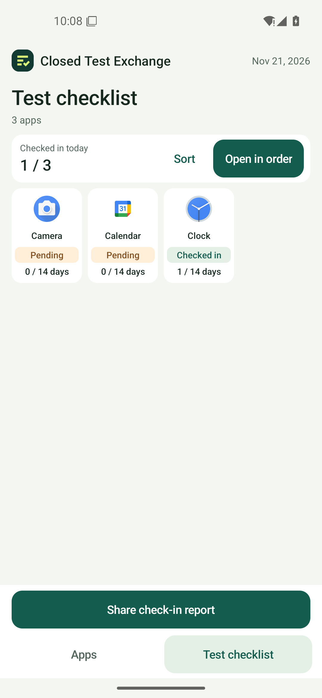
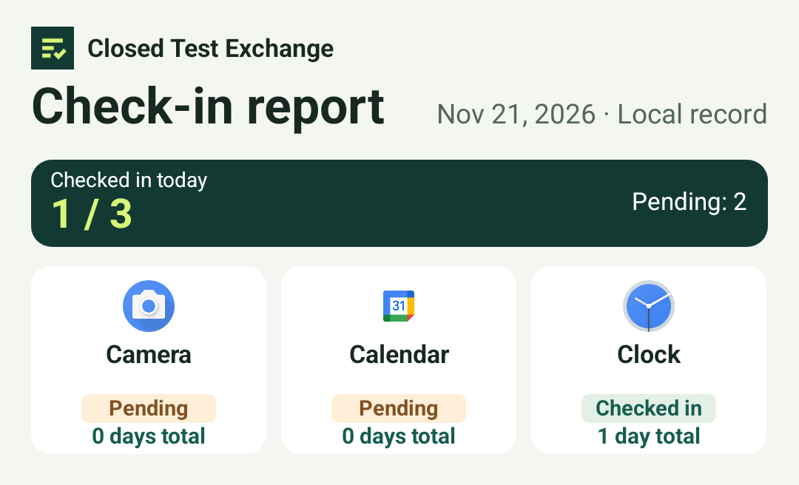

# Closed Test Exchange

[简体中文](README.zh-CN.md)

Closed Test Exchange is an Android checklist for people who test multiple apps. Keep the apps you follow in one place, record daily launch check-ins, and share your progress as a PNG.

## Install

Requires Android 7.0 or later. When an APK is available on [GitHub Releases](https://github.com/yangjiantao/closed-test-exchange/releases), download it with its SHA-256 checksum and open the APK on your device. Android may ask you to allow installs from your browser or file manager. For an in-place update, use the same distribution channel so the signature matches and Android can retain your local records. Until an APK is available, you can [build from source](#build-from-source).

The interface and reports are available in English and Simplified Chinese. On Android 13 or later, change the app language in Android Settings.

## Get started

1. In **Apps**, tap the installed apps you want to track. The most recently installed apps appear first.
2. In **Test checklist**, tap an app to open it and record a check-in. Each app counts once per calendar day on your device. **Open in order** launches the selected apps about 15 seconds apart. Android asks for permission to display the floating progress window, which includes a **Stop** button.
3. Tap **Share check-in report** to preview, save, or share a PNG. Android 10 and later save to the **Testing** album. On Android 7–9, choose a location in the system file picker.

The app keeps your checklist, most recent launch time, and check-in day count on the device. The 14-day progress indicator counts local check-in days. Google Play tracks closed-test enrollment and feedback separately in Play Console. [Google Play closed testing requirements](https://support.google.com/googleplay/android-developer/answer/14151465?hl=en)

Read the [privacy notice](PRIVACY.md) for permissions, exported reports, and how to clear your records.

## Screenshots

 

## Build from source

Use JDK 17 and Android SDK Platform 36. Set `ANDROID_HOME` to your SDK directory, or open the project in Android Studio to generate `local.properties` and run the `app` module.

```sh
./gradlew :app:assembleDebug
```

On Windows, use `gradlew.bat :app:assembleDebug`. The APK is at `app/build/outputs/apk/debug/app-debug.apk`. The application ID is `com.shanmei.tools.testing`.

## Feedback and contributions

[Open an issue](https://github.com/yangjiantao/closed-test-exchange/issues/new/choose) in English or Chinese. See the [contribution guide](CONTRIBUTING.md) for checks and [security policy](SECURITY.md) for private reporting.

## License

[MIT](LICENSE)
