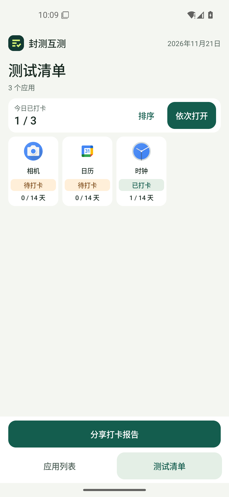
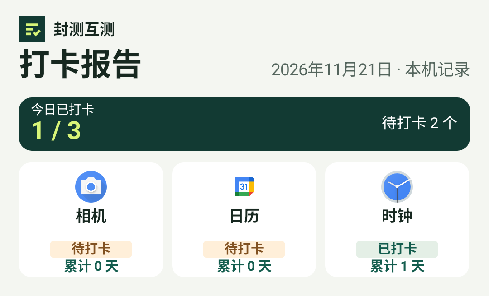

# 封测互测

[English](README.md)

封测互测是一款 Android 封闭测试记录工具。把要跟进的应用放进同一份清单，记录每日启动打卡，并将打卡进度导出为 PNG 图片。

## 安装

支持 Android 7.0 及以上版本。APK 发布后，可在 [GitHub Releases](https://github.com/yangjiantao/closed-test-exchange/releases) 下载 APK 和 SHA-256 校验值。下载后在手机上打开 APK。Android 可能会要求允许浏览器或文件管理器安装应用。升级时请沿用原来的分发渠道，Android 会在安装包签名匹配时保留本机记录。发布 APK 之前，可以[从源码构建](#从源码构建)。

界面和报告支持简体中文和英文。Android 13 及以上可在系统设置中为本应用单独选择语言。

## 快速上手

1. 在**应用列表**中点选要跟进的应用。最近安装的应用排在前面。
2. 在**测试清单**中点按应用，即可打开并记录一次启动打卡。按设备上的日历日期，每个应用每天计一次。点按**依次打开**可每隔约 15 秒切换到下一个应用。系统会请求悬浮窗权限，悬浮窗上有进度和**停止**按钮。
3. 点按**分享打卡报告**，可预览、保存或分享 PNG。Android 10 及以上保存到 **Testing** 相册。Android 7–9 通过系统文件选择器指定保存位置。

应用把测试清单、最近一次启动时间和累计打卡天数保存在本机。14 天进度显示的是本机累计打卡天数。Google Play 封测的加入时长和反馈由 Play Console 另行跟踪。 [Google Play 封测要求](https://support.google.com/googleplay/android-developer/answer/14151465?hl=zh-Hans)

有关权限、导出报告和如何清除记录，请参阅[隐私说明](PRIVACY.md#隐私说明)。

## 截图

 

## 从源码构建

需要 JDK 17 和 Android SDK Platform 36。将 `ANDROID_HOME` 指向 SDK 目录，或用 Android Studio 打开项目生成 `local.properties`，然后运行 `app` 模块。

```sh
./gradlew :app:assembleDebug
```

Windows 上使用 `gradlew.bat :app:assembleDebug`。构建产物位于 `app/build/outputs/apk/debug/app-debug.apk`。应用包名为 `com.shanmei.tools.testing`。

## 反馈与贡献

欢迎用中文或英文[提交 Issue](https://github.com/yangjiantao/closed-test-exchange/issues/new/choose)。提交代码前请参阅[贡献指南](CONTRIBUTING.md#贡献指南)，安全问题可按[安全报告指引](SECURITY.md#安全问题报告)私下反馈。

## 许可证

[MIT](LICENSE)
